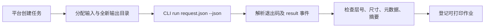

# 公共平台如何接入 FryHalftone 0.2.0

一句话：平台每个作业提供一个彩色 GLB、一个独占空目录和一组打印参数，SDK 输出一叠按 Z 编号的打印 BMP。每张 BMP 对应一层，每格对应一种材料。Windows、Linux、macOS 使用同一份 UTF-8 请求。

## 第一次接入，先跑一个已知答案

1. 解压产品 ZIP，选择与 worker 操作系统、CPU 架构匹配的 platforms 子目录。
2. 在产品根目录运行 `python -X utf8 check_install.py`。它会自动选平台，检查库和 CLI 摘要、SDK 清单、参数和 HE520 出片。以下 bin 路径相对于所选平台目录。
3. 命令行查看 `bin/fry-halftone-cli info --json` 和 `bin/fry-halftone-cli schema`，Windows 将命令名改成 `bin\fry-halftone-cli.exe`。核对版本 0.2.0、引擎 cpp 和本批算法指纹。schema 的 27 项与 [参数参考](parameters.md) 对应。
4. 在产品根目录运行下面的示例。将最后一个参数换成解压后 CLI 的**绝对路径**。只需 Python 标准库。它核对输入模型 SHA256、真正生成 HE520 切片、从磁盘重新计算摘要，最后再提交一个预期被拒绝的参数组合。

```text
python examples/platform_smoke.py /opt/fry-halftone/bin/fry-halftone-cli
python examples/platform_smoke.py "D:\SDK\fry-halftone\bin\fry-halftone-cli.exe"
```

成功件的输入是附带顶点色小盒，最长边 4 mm，输出为 109 张，落彩墨 93,870 格，色带 1.2 mm。按文件名排序拼接全部 BMP 文件字节所得 MD5 应为 `d3b79cc19e97c5f82e445f5e63d8806f`。Linux x64 和 Windows x64 上本次实跑了此脚本。其余三个目标跑了包含同一模型、同一参数的原生参考测试。 [示例输入与答案](../examples/expected.json)

## 对接已有任务系统

建议第一次集成使用 CLI，每项作业由 worker 直接启动一个子进程。提交 API 接收模型 ID、预设、尺寸和墨量合同，由服务定位模型文件、分配新输出路径。上传的模型如含同目录外链贴图，将所需贴图一起放进该任务的输入目录。多租户只允许作业访问自己在服务端分配的位置。按体素预算限制大件和并行任务数。



给一个新作业生成下列 JSON。每次替换 model 和 out，再从可执行文件所在目录调用 `fry-halftone-cli run request.json --json`。相对路径依赖 worker 的工作目录，服务端宜传绝对路径。输入路径可以包含中文，JSON 文件用 UTF-8 写入。

```json
{
  "model": "/jobs/012/input/model.glb",
  "out": "/jobs/012/output",
  "params": {
    "target_longest_edge_mm": 16.0,
    "output_width_px": 128,
    "wt_engine": "unified",
    "wt_preset": "he520",
    "wt_outward_strength": 0.5,
    "wt_outward_attenuation_mm_inv": 4.0,
    "ink_c_um": 400, "ink_m_um": 500, "ink_y_um": 300,
    "use_black_k": false, "voxel_mm": [0.137, 0.035, 0.01],
    "band_uninked_fill": "transparent", "support_enable": true,
    "threads": 2
  }
}
```

`run` 使用完整请求。另一入口 `slice 模型.glb --out 目录 --target-longest-edge 4 --params params.json --json` 中的 params.json 只装参数对象；在命令开关和文件中重复设置同一参数会报错。`--layer-height` 设 Z 间距，`--no-auto-orient` 对应模型自身 +Z 朝上、+Y 为正面。

## Worker 如何确认真正出片

- 分开读取 stdout 和 stderr。stdout 的 `--json` 模式按行输出若干 `type=progress` 事件，以及一个 `type=result` 事件。stderr 有人读的进度与诊断。代码按行解码，不把整段 stdout 当作一个 JSON。
- 平台成功条件为进程返回 0、唯一 result 内 success=true、sliceCount>0、输出文件夹与作业匹配、层号从 000000.bmp 连续且计数一致。核对 `slice_metadata.json`、`_orient.json`、所有 BMP 的调色板和一致尺寸。实际算法从 `result.sdkResult.algorithm`、`algorithm_str` 读取，保存有效参数及指纹。
- 失败记录原始库码、CLI 退出码和 error 原文。将临时作业标记失败并隔离其文件。重试分配新空目录，成功后才将作业目录发布给打印队列。取消后可能已有部分 BMP。
- X 为喷孔，Y 为运行，Z 为层号。4-bit 调色板对应空/C/M/Y/K/白/透明/支撑分别为 **0/1/3/5/7/9/11/13**。只有 0 跳喷。将切片以 RGB 软件另存，可能丢失材料编号。

|CLI 退出码|平台动作|
|---:|---|
|0|继续校验层号、宽度和元数据|
|2|参数或命令错误，退回修改作业|
|3|检查 GLB 是否存在及路径映射|
|4|更换空的可写输出目录|
|11|读取失败事件中的库码与 error，区分输入、算法和资源问题|
|12|输出不完整，隔离产物|

## 如果公共平台直接加载动态库

Windows x64 的调用约定是 `__stdcall`，Linux/macOS 使用平台默认 C ABI。Windows 可通过导入库隐式链接或用 LoadLibrary，其他平台用 dlopen。依照随包头文件绑定以下 **11** 个入口。[正式头文件](../platforms/win32-x64/include/fry_halftone.h)

|函数（公共前缀 FryHalftone_）|参数与生命周期|
|---|---|
|GetVersion、GetAlgorithmFingerprint、GetAlgorithmName、GetEngine、GetParamSchemaJson|无参数。返回库持有的静态 UTF-8 字符串，由调用方读取或复制。GetAlgorithmName 返回家族名称 water_transfer_depth，实际预设在作业结果中。|
|SliceModel、SliceModelUtf8|模型路径、输出目录、摆正后目标 Z 高度、回调、用户上下文、错误缓冲及容量。宽字符版对应 wchar_t，Utf8 版长度按字节。高度 0 保持模型尺寸，其余用默认参数。|
|SliceModelJsonUtf8|requestJson、resultJson、结果缓冲容量、回调、userData、errorBuffer、错误容量。两个缓冲以字节计。头文件建议结果缓冲 8192 字节，可预留更大空间。返回码 2 也可能来自结果缓冲不足，应看错误原文。|
|Cancel|从另一线程请求取消，运行作业在检查点退出。没有运行作业时返回成功。|
|SetWorkerPathUtf8、GetWorkerPathUtf8|为老接口保留。前者接收路径并返回成功，后者返回空串。当前在调用进程内运算。|

回调签名为 `(int percent, const char* stage, void* userData)`（UTF-8 版）。回调在调用线程同步执行，立即复制状态并交给消息队列。FFI 层必须在整个调用期间保留委托、字符串、上下文和缓冲。同进程同一库实例同一时刻运行一个作业，第二个调用可返回 6；threads 只控制单作业内部并行。需要作业隔离和并行时，使用独立 worker 进程并限制总线程及内存。

|库码|含义|
|---:|---|
|0|成功|
|1|执行失败，如宽度不足、坏模型、内存或写片问题|
|2|参数或缓冲区问题|
|3、4|历史 worker / 协议保留码|
|5|取消，已有层可能保留|
|6|库忙，进入调度队列|
|7|模型用了该版本不支持的特性，报告具体特性并转人工或兼容路径|

[C 示例](../platforms/win32-x64/examples/c/fry_halftone_demo.c) · [C# 示例](../platforms/win32-x64/examples/csharp/FryHalftoneDemo.cs) · [Python ctypes 示例](../platforms/win32-x64/examples/python/fry_halftone_demo.py)。这些为发布包原始样例。跨系统绑定优先使用 UTF-8 JSON 入口；按平台改库名和调用约定。

## 模型与上线范围

SDK 接受三维 GLB，支持材质因子、顶点色、PNG、基线 JPEG、节点变换等。渐进 JPEG、压缩几何 Draco/meshopt、无回退的 WebP/KTX2、部分未支持的必需扩展等由库报告。完整边界在随包头文件开头。库没有网络依赖，路径读写和任务隔离仍由宿主负责。服务能运行的 GPU/CPU 架构须与工作进程一致。

发布 ZIP 内的 LICENSE.txt 写明了内部产品集成许可，并对对外单独分发提出书面同意条件。公共平台若要让外部用户下载 SDK，请先由权利人确认适用授权。公开 CI 的可见性与授权范围应分别核对。[随包许可原文](../platforms/win32-x64/LICENSE.txt)
